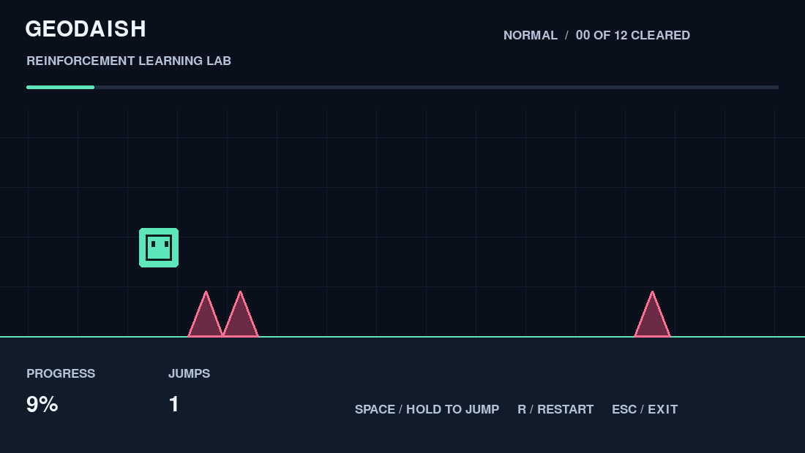

# Geodaish

Ett litet Geometry Dash-inspirerat labb för **reinforcement learning**. Spela själv,
träna en PPO-agent och jämför den mot slumpmässiga hopp på nya banor. Första målet
är att lära sig tajma hopp i en kontrollerad miljö. Slutmålet är att kunna gå vidare
till det riktiga Geometry Dash.



## Varför börja med en egen miljö?

| | Egen simulator | Riktiga Geometry Dash |
|---|---|---|
| Träningshastighet | Kör utan grafik och utan väntan mellan bildrutor | Beror på spelets hastighet och integrationsmetod |
| Observationer | Exakta avstånd, höjd och hastighet | Kräver bildtolkning eller annan integration |
| Omstarter | Omedelbara och reproducerbara | Kräver hantering av menyer, död och nya försök |
| Felsökning | Fysik, belöning och banor är kontrollerbara | Svårare att skilja styrningsfel från inlärningsfel |
| Överföring till originalet | Kräver ytterligare arbete | Träning sker direkt i målmiljön |

**Rekommendation:** börja här. Det gör det lättare att förstå RL och testa idéer
billigt. Modellen kan **inte** spela riktiga Geometry Dash ännu. Fysiken är
förenklad, och exakta speldata är enklare input än skärmbilder. Ingen automatisk
överföring utlovas.

Din **MacBook Neo med A18 Pro och 8 GB RAM** räcker för denna lilla modell. Vi kör
på CPU, med ett litet nätverk och fyra miljöer i samma process. Apple Neural Engine
används inte. GPU behövs inte för att komma igång. Uppdatering av nätverket och
antal träningssteg påverkar tidsåtgången; `benchmark` mäter bara simulatorn.

## Kom igång

Använd **Python 3.10 eller senare**, gärna 3.12. macOS system-Python 3.9 är för
gammal. På en dator där Python 3.12 finns:

```bash
git clone https://github.com/oskar-cloud/Geodaish.git
cd Geodaish
python3.12 -m venv .venv
source .venv/bin/activate
python -m pip install -e '.[dev]'
```

Projektet är privat om du har valt det på GitHub; då krävs GitHub-inloggning vid
kloning. I den redan förberedda projektmappen räcker `source .venv/bin/activate`.
`requirements-tested.txt` listar de versioner som användes vid lokal verifiering.

### Se den färdigtränade demon direkt

```bash
geodaish watch --model models/demo-normal.zip
```

Den medföljande PPO-modellen klarade **100 av 100 nya normalbanor** (seeds
20000–20099). Slumpmässiga hopp klarade **0 av 100** och den handkodade referensen
**100 av 100**. Detta gäller den förenklade simulatorn och en träningskörning,
inte originalspelet. Fullständiga resultat finns i
[`docs/evaluation-normal.json`](docs/evaluation-normal.json), och träningshistorik
i [`models/README.md`](models/README.md).

### Spela själv

```bash
geodaish play
```

**Mellanslag** håller hoppknappen nedtryckt. Kuben hoppar igen när den landar om
knappen hålls inne. **R** startar om samma bana. **Escape** stänger fönstret.

### Träna

```bash
geodaish train --steps 2000000 --output runs/my-first-agent
```

Träningen körs utan spelfönster. Var 20 000:e steg visas resultat från tio
valideringsbanor. `Ctrl+C` sparar modellen och avslutar. PPO avrundar antalet steg
uppåt till hela träningsomgångar. En körning kan behöva fler steg och olika seeds
kan ge olika resultat. Det första lokala försöket på 300 000 steg räckte inte;
därför är standardvärdet två miljoner steg.

Varje körning sparar:

- `best.zip`: bäst genomsnittlig belöning på valideringsbanorna.
- `final.zip`: modellen efter sista träningssteget.
- `latest.zip`: modellen vid senaste återkommande validering.
- `validation.csv`: andel klarade banor, framsteg och belöning över tid.
- `progress.csv`, `episodes/`: PPO-statistik och episodloggar.
- `config.json`, `summary.json`: inställningar, träningssteg och tid.

Resultat hamnar i `runs/`, som inte checkas in. Använd en ny utdatakatalog för
varje körning så att gamla resultat bevaras. Fortsätt från en egen modell:

```bash
geodaish train --resume runs/my-first-agent/best.zip --steps 300000 --output runs/continued
```

### Titta på AI:n

```bash
geodaish watch --model runs/my-first-agent/best.zip
```

Visningen går i realtid och byter bana efter avslutade försök. Du kan också se en
**handkodad referens**, som används för att kontrollera att banorna går att klara:

```bash
geodaish watch --policy heuristic
```

Referensen är inte en tränad AI och ska inte räknas som ett RL-resultat.

### Mät om AI:n har lärt sig

```bash
geodaish evaluate --model runs/my-first-agent/best.zip --episodes 100 --output runs/evaluation.json
```

Alla agenter får samma testbanor. Kommandot jämför PPO, slumpmässiga hopp och den
handkodade referensen. Det rapporterar **andel klarade banor**, **genomsnittlig
andel av banan** och **belöning**, samt kan spara varje försök som JSON.
Valideringen använder seeds 10000–10009; separat slututvärdering börjar på 20000.
Ändra inte modellen utifrån sluttestet om du vill behålla det som ett orört test.
Flera träningsseeds behövs för ett robust påstående om algoritmens prestanda.

### Svårighet och prestanda

Alla kommandon accepterar `--difficulty easy`, `normal` eller `hard`. Använd samma
svårighet när du tränar och utvärderar, om du inte avsiktligt testar överföring.

```bash
geodaish train --difficulty easy --steps 200000 --output runs/easy
geodaish benchmark --steps 100000
python -m pytest -q
```

## Vad lär sig modellen?

**Observationer (16 tal):** kubens höjd, vertikala hastighet, markkontakt,
horisontella hastighet och avstånd/bredd/höjd/närvaro för tre kommande
hindergrupper. Värdena normaliseras. Modellen får inte banans seed eller absoluta
position. Observationsräckvidden är 16 spelenheter.

**Handlingar:** `0` = släpp hopp, `1` = håll hopp. Ingen dubbelhoppning.

**Belöning:** `+0,01` per steg, `+1` per passerad hindergrupp, `−5` vid kollision,
`+10` vid målgång. Framåtrörelse sker automatiskt, så agenten kan inte stanna och
samla belöning. Död och målgång avslutar episoden; tidsgräns är en separat
trunkering enligt Gymnasium.

**Fysik:** 60 beslut per simulerad sekund med två fysikdelsteg per beslut.
Rendering påverkar inte simuleringen. Banorna består av platt mark och
triangelformade spikar, med mellanrum för landning och nästa hopp. Spelet saknar
ännu plattformar, gravitationsportaler, flygsektioner och originalets fysik.

**Algoritm:** Stable-Baselines3 PPO med två dolda lager om 64 neuroner. Ingen
handkodad hoppregel används för PPO-träningen. Miljön följer Gymnasium-API:t och
kan användas av andra algoritmer.

## Vägen till riktiga Geometry Dash

1. Få reproducerbara RL-resultat i denna miljö och prova flera träningsseeds.
2. Mät och matcha originalets hopphöjd, hastighet, kollisioner och knappbeteende.
3. Lägg till relevanta banmekaniker stegvis och kontrollera att banorna går att klara.
4. Bygg en adapter för skärmbilder och knapptryckningar. Börja med att upptäcka kub
   och hinder och omvandla dem till samma observationer. Alternativt träna en ny
   bildbaserad modell; den kräver ett annat nätverk och mer träning.
5. Hantera inmatningsfördröjning och observationer över flera bildrutor; utvärdera
   sedan och finjustera mot en enkel bana i originalspelet.

`DashEnv` är skild från `Renderer` så att träning och visning inte behöver dela
implementation med en framtida originalspelsadapter. Någon sådan adapter finns
inte i denna version. Egen grafik används; inga Geometry Dash-filer ingår.

## Källor

- [Gymnasium: skapa en egen miljö](https://gymnasium.farama.org/introduction/create_custom_env/)
- [Stable-Baselines3: PPO och CPU-träning](https://stable-baselines3.readthedocs.io/en/master/modules/ppo.html)
- [Stable-Baselines3: separat utvärdering och RL-begränsningar](https://stable-baselines3.readthedocs.io/en/master/guide/rl_tips.html)
